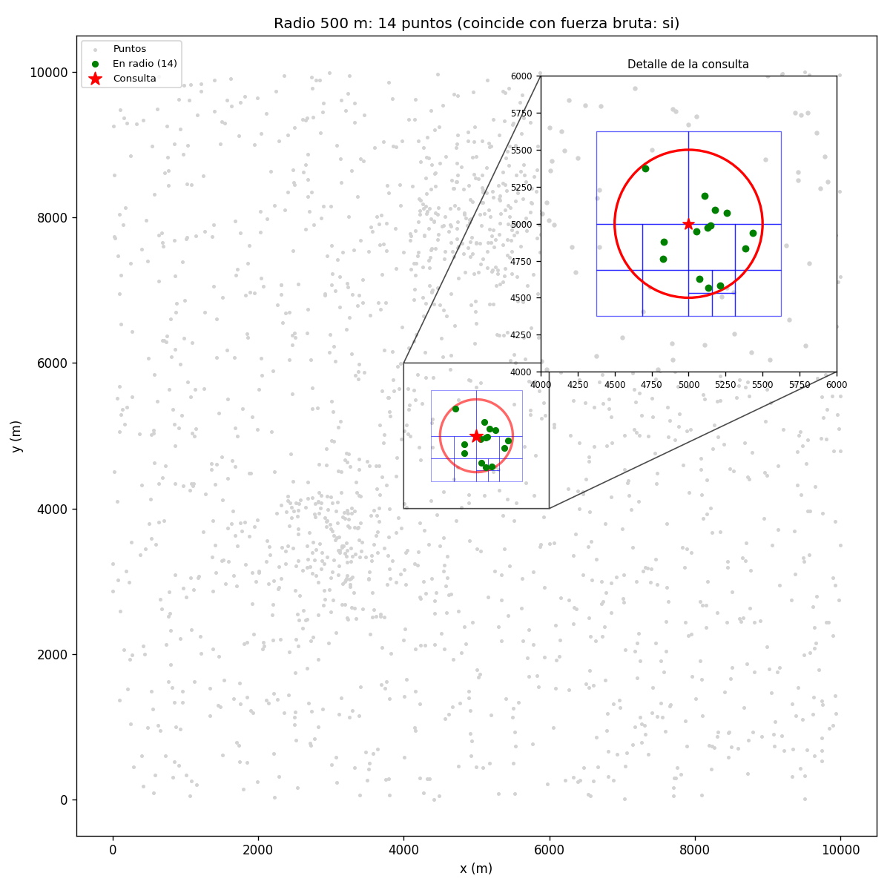
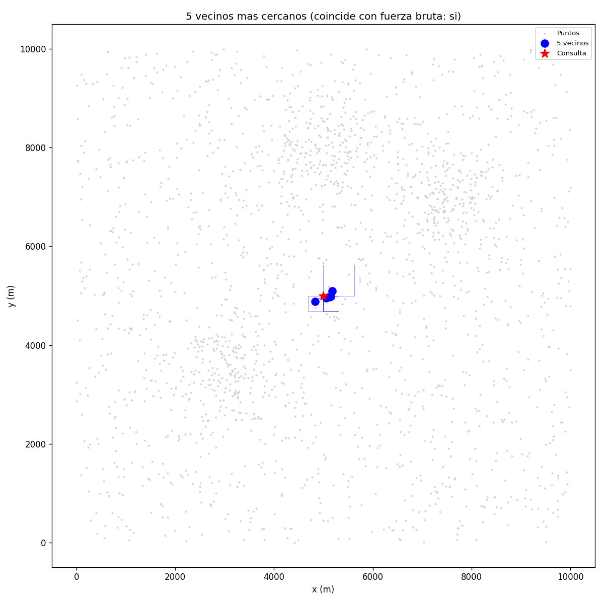
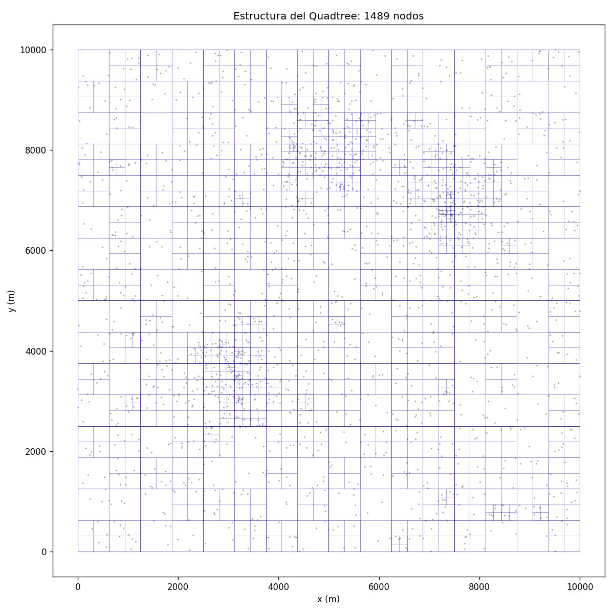
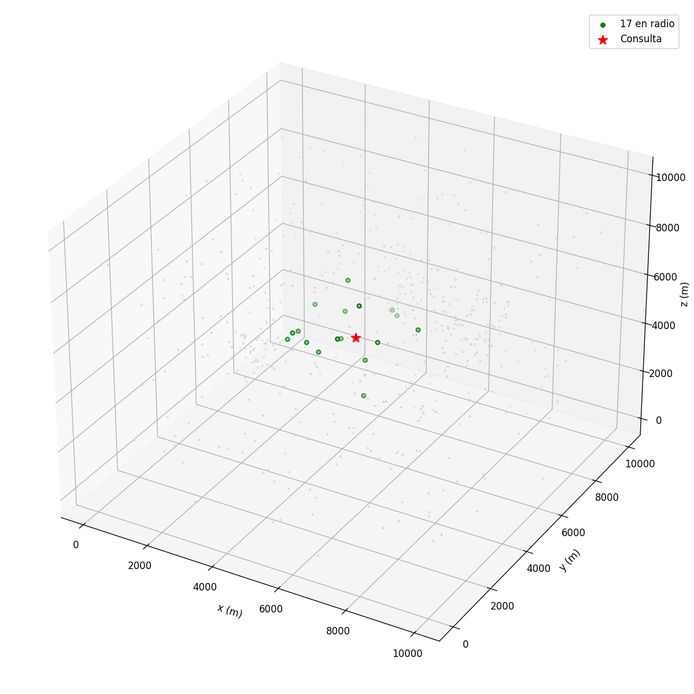
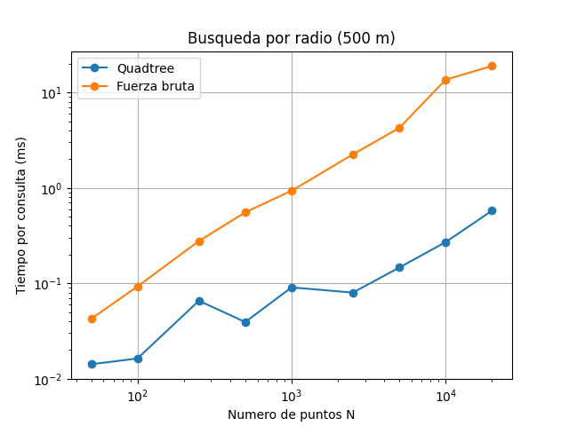
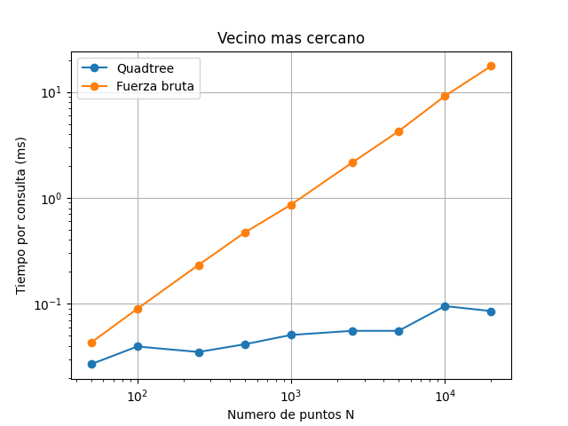
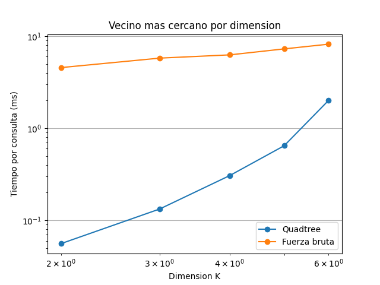

# Laboratorio 4 — Quadtree K-dimensional para logística de entregas

**Autor:** Jhon Deivy Rodas Morales  
**Curso:** Estructuras de Datos

El proyecto trabaja con puntos de entrega estáticos en una ciudad y responde dos consultas:

1. Encontrar los puntos que están a un radio de 500 m de una ubicación.
2. Encontrar el punto más cercano y, también, los *k* puntos más cercanos.

Se implementa un Quadtree desde cero, generalizado a K dimensiones, y se compara con una búsqueda por fuerza bruta sobre una lista.

## 1. Estructura del proyecto

| Archivo | Contenido |
|---|---|
| `Quadtreetree.py` | Clases `Punto`, `Rectangulo` y `Quadtree`; búsquedas por radio y vecinos; funciones de fuerza bruta y generador de datos. |
| `test.py` | 39 pruebas unitarias y visualizaciones de radio, vecinos, estructura y un ejemplo 3D. |
| `analisis.py` | Comparación de tiempos según el tamaño N y la dimensión K; genera tres gráficas y presenta una discusión en consola. |
| `graficas/` | Imágenes producidas por `test.py` y `analisis.py`. |

## 2. Ejecución

Se requiere Python 3.8 o posterior y `matplotlib`.

```bash
pip install matplotlib
python test.py
python analisis.py
```

`test.py` genera las visualizaciones y luego ejecuta las 39 pruebas. `analisis.py` ejecuta los experimentos y guarda sus gráficas en `graficas/`.

## 3. Supuestos y decisiones de diseño

- **Unidades:** cada unidad representa un metro. El mapa sintético va de 0 a 10.000 m por dimensión. El radio usado en las consultas de rango es de 500 m.
- **Datos:** `generar_datos_ciudad` genera 70 % de puntos uniformes y 30 % distribuidos en tres zonas densas gaussianas con σ = 600 m. Usa una semilla y devuelve exactamente N puntos.
- **Consultas diferentes:** una búsqueda por radio devuelve todos los puntos dentro del radio. El vecino más cercano puede estar fuera de ese radio. También se implementa la búsqueda de *k* vecinos.
- **Dimensiones:** al dividir un nodo se crean 2^K hijos: cuatro en 2D y ocho en 3D. Para elegir el hijo, el bit *j* vale 1 si `coords[j] >= centro[j]`; los puntos en la frontera quedan en la mitad superior.
- **Parámetros:** la capacidad predeterminada es de 4 puntos por hoja y la profundidad máxima es 15. Al alcanzar la profundidad máxima, una hoja puede superar su capacidad.
- **Límite de dimensión:** `K_MAX` es 8 porque el número de hijos por nodo crece como 2^K.
- **Validaciones:** se comprueba la dimensión de puntos y consultas. Las consultas de radio rechazan radios negativos. `insertar` devuelve `False` si el punto está fuera de los límites del árbol.
- **Distancias:** en la búsqueda por radio y la poda se comparan distancias al cuadrado para evitar calcular raíces innecesarias.

## 4. Algoritmos

- **Inserción:** el punto se envía al hijo que corresponde a sus coordenadas. Si una hoja supera su capacidad antes de llegar a la profundidad máxima, se divide y redistribuye los puntos.
- **Búsqueda por radio:** se calcula la distancia mínima entre la consulta y la caja de cada nodo. Si supera el radio, se descarta ese subárbol. En las hojas se revisan los puntos; el borde del radio se incluye.
- **Vecinos más cercanos:** se visitan primero los hijos cuyas cajas están más cerca de la consulta. Se conserva la lista de los mejores *k* puntos y se descartan las cajas que no pueden mejorarla.
- **Costos:** fuerza bruta revisa O(N) puntos por consulta. El Quadtree puede descartar regiones, pero su rendimiento depende de la distribución, la dimensión y el radio, y en el peor caso puede acercarse a O(N). Construir el árbol requiere insertar todos los puntos y subdividir las hojas necesarias.

## 5. Pruebas y verificación visual

Las 39 pruebas se agrupan así:

- **Geometría (12):** puntos y cajas en varias dimensiones, distancias, cobertura de los 2^K hijos e índice del hijo.
- **Quadtree (22):** inserción y conteo; búsquedas por radio y k vecinos comparadas con fuerza bruta; dimensiones K = 1, 2, 3 y 5; puntos duplicados, árbol vacío, radios cero y negativos, límites de la caja y distancia exactamente igual al radio.
- **Datos (5):** cantidad exacta, reproducibilidad, límites y consistencia de dimensiones del generador.

Las gráficas de `test.py` permiten revisar la búsqueda por radio, los vecinos, la estructura del árbol y una consulta 3D. El título de radio y vecinos indica si el resultado coincide con fuerza bruta. La gráfica de radio incluye un detalle ampliado alrededor de la consulta.









Con 2.000 puntos y los parámetros de visualización actuales, el árbol tiene 1.489 nodos.

## 6. Análisis comparativo

`analisis.py` mide el promedio de 50 consultas aleatorias para cada tamaño N, con radio de 500 m, y el promedio de 30 consultas de vecino más cercano para cada dimensión. Los árboles se construyen sobre el mapa completo. Cada punto de las gráficas corresponde a una medición; no se hacen repeticiones ni se calcula una mediana. Los tiempos dependen del equipo y de las consultas generadas al ejecutar el programa.

### ¿Desde qué tamaño gana el Quadtree a fuerza bruta?

El experimento actual empieza en N = 50. En la última corrida registrada, el Quadtree ya fue más rápido en ese primer tamaño probado; por lo tanto, el cruce está en N = 50 o por debajo, pero no se midieron tamaños menores y no se puede afirmar un valor exacto.





En N = 20.000, una corrida registró:

| Consulta | Quadtree (ms) | Fuerza bruta (ms) | Ventaja aproximada |
|---|---:|---:|---:|
| Radio de 500 m | 0,6201 | 23,5348 | 38× |
| Vecino más cercano | 0,1597 | 20,1405 | 126× |

Construir el árbol para esos 20.000 puntos tomó 1,089 s. Con esos tiempos, el costo de construcción se recuperó después de aproximadamente 48 consultas por radio o 55 consultas de vecino cercano. En general, si se hacen pocas consultas, fuerza bruta evita el costo inicial de construir el árbol; para muchos puntos estáticos y muchas consultas, el árbol puede compensarlo.

### Efecto de la dimensión K



Con N = 5.000, en esa corrida la ventaja del Quadtree para vecino más cercano bajó de aproximadamente 76,62× en K = 2 a 4,07× en K = 6. El tiempo del árbol pasó de 0,0693 ms a 2,2946 ms. En dimensiones altas se crean más hijos por subdivisión y la poda pierde eficacia. El árbol todavía fue más rápido en las dimensiones medidas, pero la diferencia se redujo.

## 7. Limitaciones

- Los resultados de rendimiento provienen de una sola corrida por tamaño, sin repeticiones. Pequeñas diferencias pueden deberse al ruido del sistema y a las consultas aleatorias.
- Los datos y las consultas son sintéticos; las coordenadas geográficas reales tendrían que convertirse a unidades métricas.
- No se estudian actualizaciones ni eliminaciones. El árbol está pensado para puntos estáticos.
- No se comparan otros índices espaciales. Para dimensiones altas, un árbol que divida una sola dimensión por nivel podría ser más adecuado.

## 8. Codigo de Honor

Durante el trabajo se utilizó Copilot en VS Code como apoyo para revisar y corregir errores durante el desarrollo.

Se usó Claude (Anthropic) como apoyo para discutir el diseño de la generalización a K dimensiones, revisar pruebas y resultados.

Se conto con la asesoria de una persona que trabaja con los arboles Quadtreetree, ayudando con algunas sugerencias como:
- El uso de operaciones a nivel de bits (1 << j) para calcular eficientemente el índice del hijo en $K$ dimensiones sin necesidad de condicionales anidados.
- Trabajar con distancias al cuadrado en las funciones de poda y búsqueda por radio para evitar el costo de computar raíces cuadradas innecesarias (math.sqrt).
- La estrategia de ordenar los hijos por su distancia mínima antes de descender en la búsqueda de los $k$ vecinos más cercanos ($k$-NN).